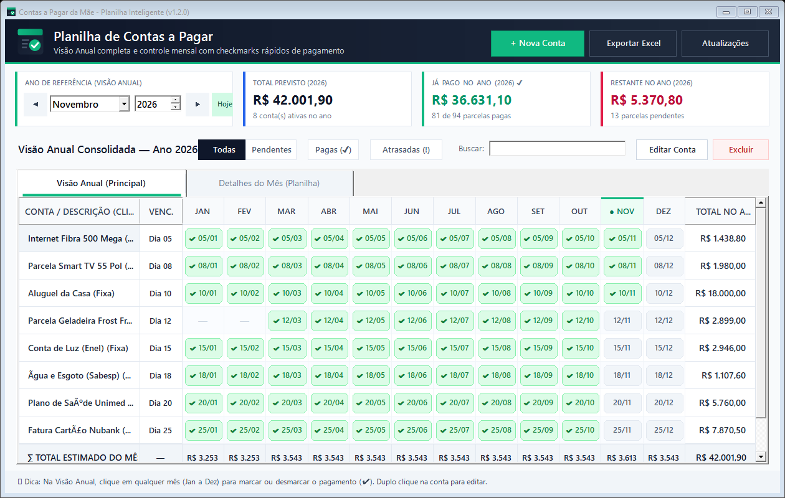
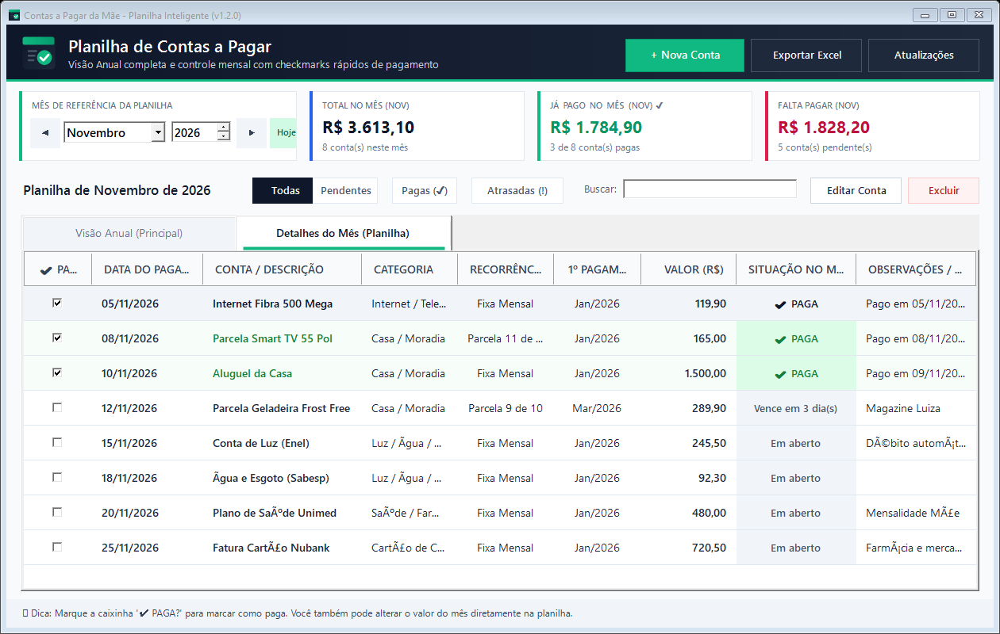
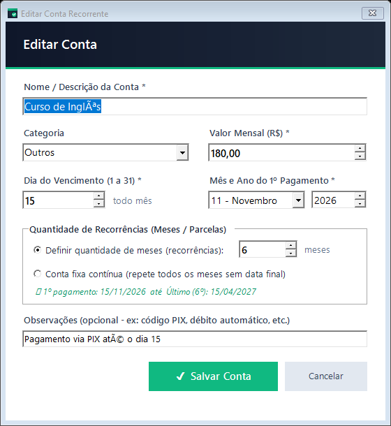

<div align="center">
  
  <h1>📋 Contas a Pagar da Mãe — Planilha Inteligente</h1>
  <p><b>Aplicativo moderno para Windows em formato de planilha visual para controle descomplicado de contas fixas, recorrentes e parceladas.</b></p>
  <p>
    <a href="https://github.com/BrenoSGTO/app-contas-a-pagar-mae/releases/latest/download/Instalador-ContasAPagar.zip">
      
    </a>
  </p>
</div>

---

## 📸 Como o Aplicativo Funciona (Telas do App)

### 1. 🌟 Visão Anual Consolidada (Aba Principal)
A aba principal traz a visão anual dos 12 meses lado a lado (Janeiro a Dezembro) em formato de matriz limpa e moderna:



- **Cartões Anuais no Topo**: Acompanhe o **Total Previsto no Ano**, o **Total Já Pago** com quantidade de parcelas quitadas e o **Restante no Ano**.
- **Badges de Pagamento Mensais**: Cada mês exibe um selo estilizado com a data (`✔ dd/MM` em verde para meses pagos; `dd/MM` suave para meses pendentes; `—` para meses sem parcela).
- **Checkmark com 1 Clique**: Clique diretamente em qualquer célula de mês (Jan a Dez) para alternar entre pago e pendente instantaneamente.
- **Linhas de Rodapé Automáticas**:
  - `∑ TOTAL ESTIMADO DO MÊS`: Soma consolidada de todas as contas para cada um dos 12 meses do ano.
  - Total geral previsto no ano na última coluna.
- **Filtros Rápidos e Busca**: Filtre com um clique por *Todas*, *Pendentes*, *Pagas (✔)* ou *Atrasadas (!)*, além do campo de busca em tempo real.

---

### 2. 📅 Detalhes do Mês (Visão Planilha Mensal)
Para quem deseja conferir os detalhes minuciosos de um mês específico, ver comprovantes ou alterar o valor de contas variáveis:



- **Caixa de Seleção `✔ PAGA?`**: Checkbox para marcar o pagamento do mês com um clique.
- **Edição Rápida de Valor**: Se a conta de luz ou fatura de cartão veio com valor diferente do padrão, basta clicar duas vezes na célula de valor da planilha e digitar o valor exato.
- **Resumo Mensal em Tempo Real**: Cartões de **Total no Mês**, **Já Pago no Mês** e **Falta Pagar** atualizados a cada clique.
- **Alertas de Vencimento**: Mostra com clareza a situação (*Vence em X dia(s)*, *Vence hoje*, *Em aberto* ou *Atrasada*).

---

### 3. ➕ Cadastro Inteligente de Contas (Fixas vs Parceladas)
Cadastrar uma conta nova leva menos de 10 segundos:



- **Contas Fixas Contínuas**: Marque essa opção para contas mensais que se repetem indefinidamente sem data de término (ex: Aluguel, Luz, Água, Internet, Condomínio, Plano de Saúde).
- **Contas Parceladas (Recorrências)**: Defina a quantidade de parcelas (ex: 6x, 10x, 12x, 24x) e o mês de início (ex: Novembro/2026). O sistema calcula sozinho a data da primeira e da última parcela.
- **Categorias e Observações**: Organize por categoria (*Casa*, *Luz/Água*, *Internet*, *Cartão de Crédito*, *Saúde*, etc.) e adicione notas de PIX ou código de barras.

---

## 📥 Download e Instalação

👉 **[CLIQUE AQUI PARA BAIXAR O INSTALADOR (`Instalador-ContasAPagar.zip`)](https://github.com/BrenoSGTO/app-contas-a-pagar-mae/releases/latest/download/Instalador-ContasAPagar.zip)**

### Passo a passo para instalar:
1. Baixe o arquivo **`Instalador-ContasAPagar.zip`** pelo link acima.
2. Abra o arquivo `.zip` e execute o **`instalador.exe`**.
3. Clique no botão verde **"Instalar Agora"**.
4. Pronto! O atalho **"Contas a Pagar"** será criado na Área de Trabalho com o novo ícone do aplicativo.

---

## 🔄 Atualizações Automáticas com 1 Clique

O aplicativo possui atualização automática integrada via GitHub Releases:
- Basta clicar no botão **"Atualizações"** no topo direito do programa.
- O programa consulta as novas versões publicadas neste repositório, baixa e instala a atualização sozinho, **sem perder nenhuma conta ou histórico de pagamentos já cadastrado**.

---

## 🛠️ Para Desenvolvedores: Como Compilar e Publicar

Requisitos: Windows com .NET Framework 4.5+ e PowerShell (nativos em qualquer Windows 7/8/10/11).

### Compilação local:
```powershell
powershell -ExecutionPolicy Bypass -File .\build.ps1
```
O script gera:
- `dist/ContasAPagar.exe`: Executável standalone com manifest e ícone em alta definição.
- `dist/instalador.exe`: Instalador com interface gráfica.
- `dist/Instalador-ContasAPagar.zip`: Pacote compactado pronto para distribuição.

### Publicando uma nova versão:
1. Altere a constante `AppVersion` em [`src/ContasAPagar.cs`](src/ContasAPagar.cs).
2. Execute o build:
   ```powershell
   powershell -ExecutionPolicy Bypass -File .\build.ps1
   ```
3. Crie uma nova release com o GitHub CLI ou pela interface do GitHub:
   ```powershell
   gh release create v1.2.0 dist/Instalador-ContasAPagar.zip dist/ContasAPagar.exe --title "Versão 1.2.0" --notes "Visão Anual como principal, nova identidade visual moderna e correções visuais."
   ```
